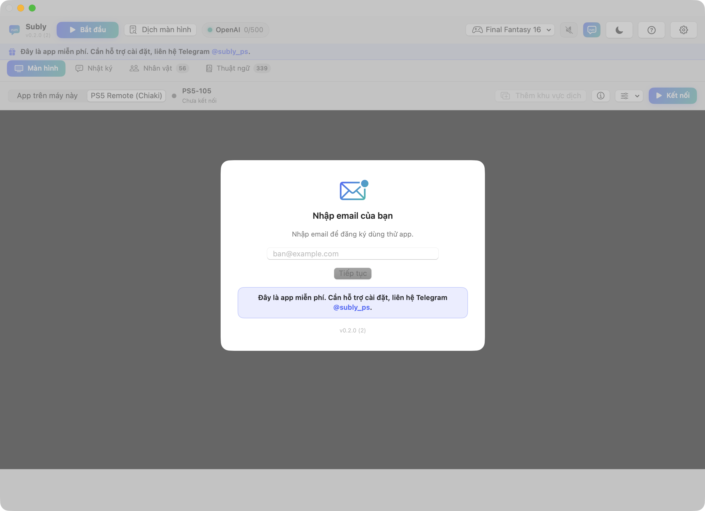
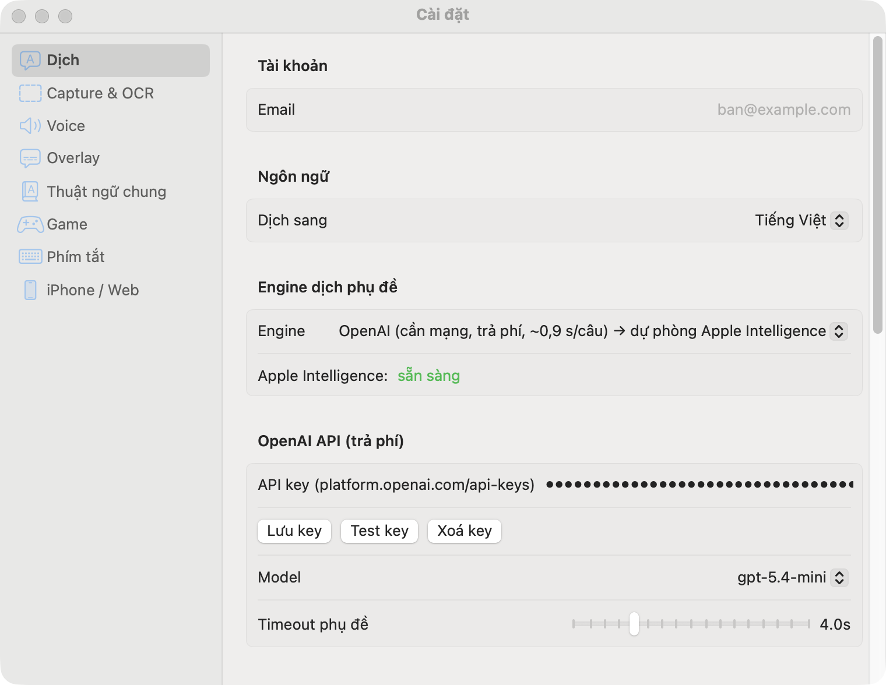

# Subly

Dịch phụ đề game và phim theo thời gian thực trên macOS: lấy hình từ PS5 (Remote Play) hoặc từ cửa sổ trên máy, nhận chữ, dịch sang tiếng Việt, hiện phụ đề và đọc bằng giọng nói. App miễn phí.

Tải bản mới nhất ở mục **[Releases](https://github.com/subly-ps/Subly-release/releases)**.

> [!CAUTION]
> **ĐỌC TRƯỚC KHI MỞ APP.** macOS sẽ chặn Subly vì app chưa đăng ký với Apple. Sau khi kéo `Subly.app` vào thư mục Applications, làm **một trong hai** cách:
>
> **Cách 1:** bấm **chuột phải vào Subly → Open → Open**.
>
> **Cách 2:** mở Terminal, dán lệnh sau rồi Enter:
> ```
> xattr -dr com.apple.quarantine /Applications/Subly.app
> ```
> Nếu macOS báo app "damaged" hoặc cách 1 không mở được thì dùng cách 2.



## Cài đặt

Yêu cầu: macOS 15 trở lên, máy Mac chip Apple (M1 trở lên).

1. Tải file `Subly-x.y.z-macOS.zip` ở Releases, giải nén, kéo `Subly.app` vào thư mục **Applications**.
2. Mở app theo hướng dẫn ở khung đỏ đầu trang (chuột phải → Open, hoặc lệnh Terminal).
3. App hỏi email để đăng ký máy, nhập rồi bấm tiếp. Máy được dùng ngay.
4. Khi dùng nguồn "App trên máy này", macOS hỏi quyền **Ghi màn hình**: cho phép rồi mở lại app.

## Kết nối PS5 (Remote Play / Chiaki)

App nối thẳng tới PS5 qua giao thức Remote Play (dùng thư viện chiaki-ng) để lấy hình. App chỉ nhận hình để dịch, không gửi điều khiển, không phát tiếng: bạn vẫn chơi bằng tay cầm nối với PS5 và xem trên TV như bình thường.

**Trên PS5** (làm một lần): Settings → System → Remote Play → bật *Enable Remote Play* → *Link Device* để lấy mã PIN 8 số.

**Trong app**: mở tab **Màn hình**, chọn **PS5 Remote (Chiaki)**, rồi làm một trong hai cách:

- Đã cài và đăng ký PS5 trong chiaki-ng trên máy này: bấm **Nhập từ chiaki-ng**. Xong, không cần PIN.
- Chưa có chiaki-ng:
  1. Nhập **IP của PS5** hoặc bấm *Tìm trong mạng*.
  2. Nhập **PSN Account ID**. Chưa có thì bấm *Mở trang đăng nhập PSN*, đăng nhập tài khoản Sony, khi trang chuyển sang địa chỉ có chữ `redirect` thì copy toàn bộ URL, dán vào ô trong app và bấm *Lấy Account ID*.
  3. Nhập **mã PIN** 8 số từ PS5, bấm **Đăng ký**.

Sau đó bấm **Kết nối**. Hình PS5 hiện trong app. Nút **ⓘ** cạnh nút cài đặt cho xem lại cấu hình đã lưu (IP, MAC, Account ID, khoá đăng ký). Menu **⚙** bên cạnh chỉnh độ phân giải 720p/1080p, 30/60 fps, tự dịch khi có hình, và *Quên máy này* để đăng ký lại.

Mẹo: Mac và PS5 nên cùng một mạng, tốt nhất là dây mạng. Nhiều card mạng hoặc VPN bật cùng lúc dễ làm rớt kết nối.

## Dùng hằng ngày

1. **Vẽ khung phụ đề**: bấm *Thêm khu vực dịch* rồi kéo chuột quanh vùng phụ đề trên hình. Kéo để dời, kéo góc để đổi cỡ. Game hiện tên người nói ở dòng riêng thì vẽ bao cả dòng tên.
2. **Bắt đầu** (hoặc ⌥⌘S): app dịch phụ đề liên tục, hiện bản dịch đè trên màn hình (overlay) và ghi vào Nhật ký.
3. **Giọng đọc**: nút loa trên thanh công cụ (⌥⌘V). Mặc định tắt. Giọng chọn trong Cài đặt → Voice (giọng Apple, giọng AI offline tiếng Việt, hoặc Microsoft Edge).
4. **Dịch màn hình** (⌥⌘T): khi game hiện bảng dài như nhật ký nhiệm vụ, tiểu sử, menu. App chụp, dịch toàn bộ chữ đặt đúng vị trí và tóm tắt nội dung. Xem lại ở Nhật ký → Dịch màn hình.
5. **Nhân vật** và **Thuật ngữ**: tên nhân vật, thuật ngữ riêng của game để dịch đúng và nhất quán. App có sẵn bộ thuật ngữ cho nhiều game phổ biến.
6. **Xem trên điện thoại / TV**: Cài đặt → iPhone / Web, quét mã QR để mở trang phụ đề trên thiết bị cùng Wi-Fi.

## Engine dịch

Cài đặt → Dịch. Mặc định *Tự động*.

| Engine | Chi phí | Ghi chú |
|---|---|---|
| Apple Intelligence | Miễn phí, offline | Cần bật Apple Intelligence trong System Settings. Khoảng 0,8 s mỗi câu |
| Apple Translation | Miễn phí, offline | Nhanh nhất, chất lượng vừa |
| Gemini | Miễn phí (key free tier) | Lấy key ở aistudio.google.com/apikey |
| OpenAI | Trả phí | Lấy key ở platform.openai.com, rất rẻ cho phụ đề |

Dịch màn hình mặc định dùng cùng engine với phụ đề, có thể chọn riêng ở mục *Dịch màn hình (thủ công)*.



## Phím tắt

| Phím | Chức năng |
|---|---|
| ⌥⌘S | Bắt đầu / Dừng dịch phụ đề |
| ⌥⌘T | Dịch màn hình |
| ⌥⌘V | Bật / tắt giọng đọc |
| ⌥⌘O | Bật / tắt overlay |
| ⌘, | Cài đặt |

Đổi phím ở Cài đặt → Phím tắt.

## Sự cố thường gặp

| Hiện tượng | Cách xử lý |
|---|---|
| Không thấy phụ đề dịch | Đã bấm Bắt đầu chưa, khung đã bao đúng vùng phụ đề chưa, overlay (💬) đã bật chưa |
| Nhận nhầm nút giao diện (Quick Save, Back) | Cài đặt → Capture & OCR: bật *Chỉ nhận chữ nằm giữa khung* và *Bỏ qua chữ giao diện* |
| Dịch chậm | Đổi engine sang Apple Intelligence hoặc OpenAI. Gemini miễn phí hay nghẽn giờ cao điểm |
| PS5 mất kết nối giữa chừng | Dùng dây mạng, tắt bớt Wi-Fi/VPN, bấm Kết nối lại |
| Không tìm thấy PS5 | PS5 phải bật hoặc ở chế độ nghỉ có bật mạng, cùng mạng với Mac |
| App không mở được | Xem khung đỏ đầu trang |

## Hỗ trợ

Telegram: [@subly_ps](https://t.me/subly_ps)
